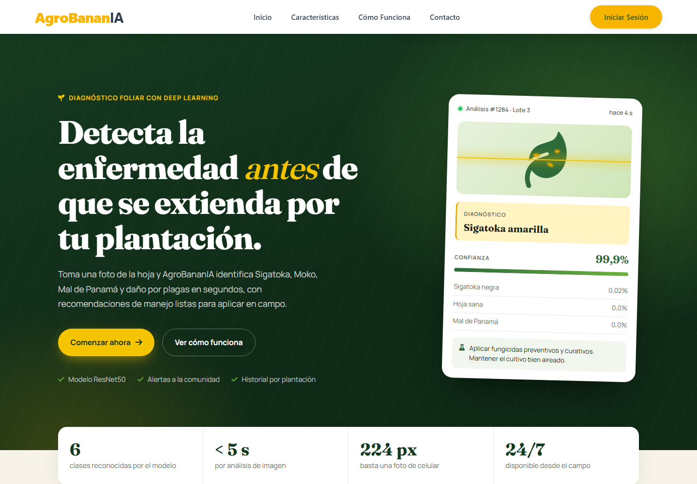
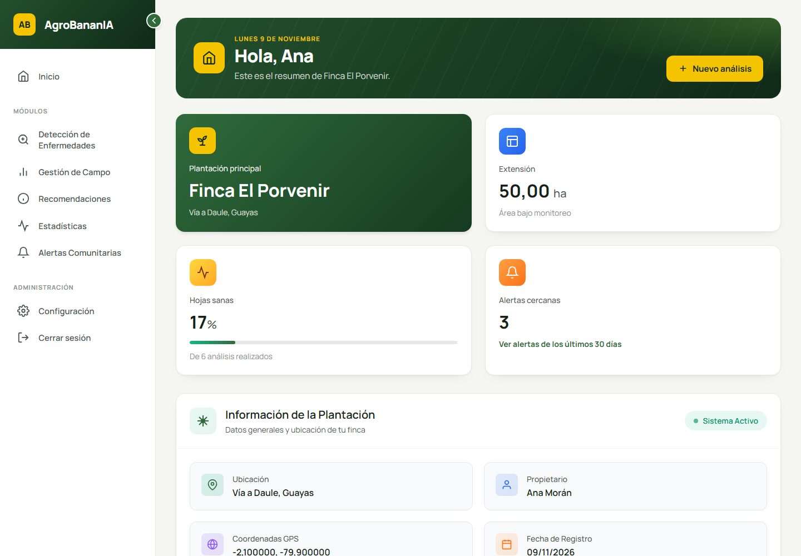
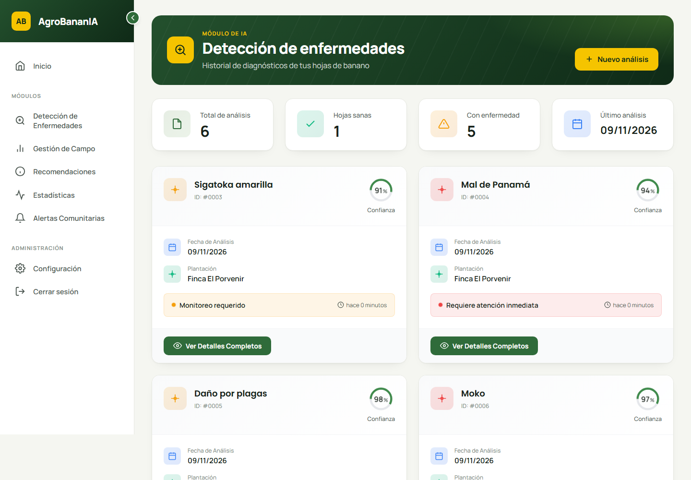
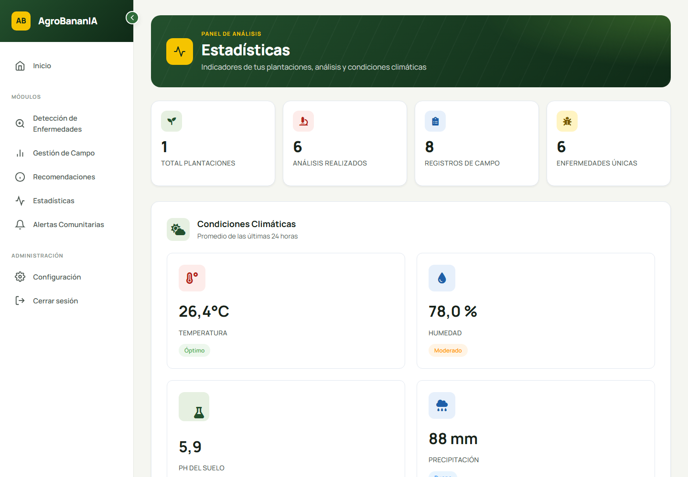
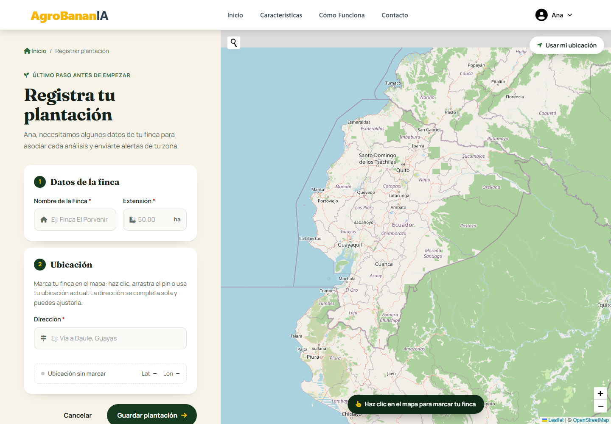
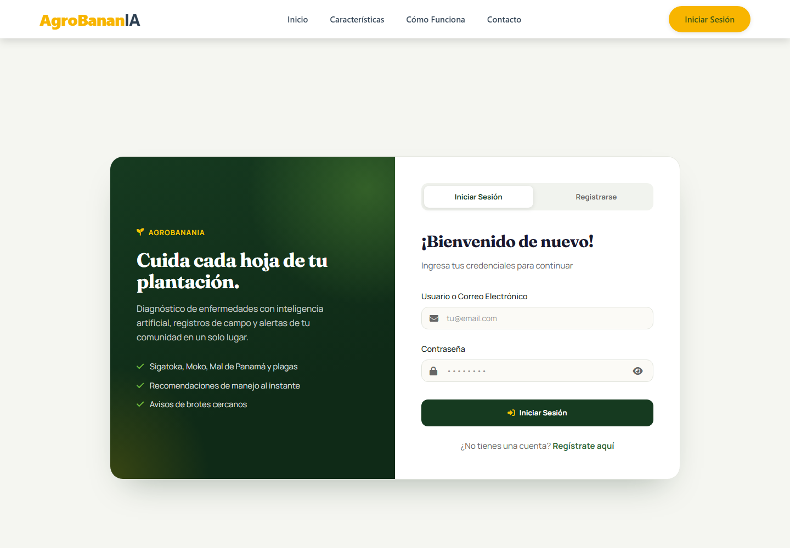

<div align="center">

# 🍌 AgroBananIA

**Diagnóstico de enfermedades en hojas de banano con inteligencia artificial**

Sube una foto de la hoja y AgroBananIA identifica la enfermedad, sugiere cómo manejarla
y avisa a los productores cercanos para frenar la propagación.




</div>

---

## Contenido

- [Qué hace](#qué-hace)
- [Capturas](#capturas)
- [Enfermedades que detecta](#enfermedades-que-detecta)
- [Tecnologías](#tecnologías)
- [Instalación](#instalación)
- [Variables de entorno](#variables-de-entorno)
- [Estructura del proyecto](#estructura-del-proyecto)
- [Cómo funciona la detección](#cómo-funciona-la-detección)
- [Problemas comunes](#problemas-comunes)
- [Autor](#autor)

## Qué hace

| Módulo | Descripción |
|---|---|
| 🔍 **Detección de enfermedades** | Clasifica una foto de la hoja con un modelo ResNet50 y muestra la confianza por clase, la recomendación de manejo y el historial de análisis. |
| 🔔 **Alertas comunitarias** | Al confirmar un diagnóstico, avisa por correo a los productores con plantaciones a **2 km o menos** y registra la alerta en el sistema. |
| 🌱 **Gestión de campo** | Registro de clima (temperatura, humedad, precipitación), suelo (pH, humedad, nitrógeno) y labores agrícolas, con el clima actual de la plantación. |
| 💡 **Recomendaciones** | Protocolos de manejo para cada enfermedad, con enlaces a fuentes científicas. |
| 📈 **Estadísticas** | Indicadores de plantaciones, análisis y clima, con gráficas de tendencia y distribución de enfermedades. |
| 🗺️ **Plantaciones** | Registro de la finca con su ubicación en un mapa interactivo (búsqueda, GPS del dispositivo y dirección automática). |

## Capturas

| Panel principal | Historial de detección |
|---|---|
|  |  |
| **Estadísticas** | **Registro de plantación** |
|  |  |

<details>
<summary>Inicio de sesión</summary>
<br />

</details>

## Enfermedades que detecta

El modelo clasifica cada imagen en una de **6 clases**:

| Clase del modelo | Nombre en la app | Severidad |
|---|---|---|
| `Banana Black Sigatoka Disease` | Sigatoka negra | 🔴 Alta |
| `Banana Moko Disease` | Moko | 🔴 Alta |
| `Banana Panama Disease` | Mal de Panamá | 🔴 Alta |
| `Banana Yellow Sigatoka Disease` | Sigatoka amarilla | 🟡 Media |
| `Banana Insect Pest Disease` | Daño por plagas | 🟡 Media |
| `Banana Healthy Leaf` | Hoja sana | 🟢 Sin enfermedad |

## Tecnologías

- **Backend:** Python, Django 5.2
- **IA:** TensorFlow / Keras (ResNet50), OpenCV, NumPy
- **Base de datos:** SQLite
- **Frontend:** HTML, CSS y JavaScript sin frameworks, [Chart.js](https://www.chartjs.org/) para gráficas y [Leaflet](https://leafletjs.com/) + OpenStreetMap para mapas
- **Servicios externos:** [WeatherAPI](https://www.weatherapi.com/) (clima actual), Nominatim de OpenStreetMap (direcciones) y SMTP de Gmail (alertas por correo)

## Instalación

### Requisitos

- **Python 3.9 a 3.13.** TensorFlow 2.20 no es compatible con Python 3.14 (probado con 3.12).
- Git
- El archivo del modelo entrenado `model_resnet50_final_optimized.keras` (no está en el repositorio por su tamaño; ver el paso 5).

### Pasos

**1. Clonar el repositorio**

```bash
git clone https://github.com/victorC0103/AgroBananIA.git
cd AgroBananIA/AgroBananIA
```

> El código de Django está en la subcarpeta `AgroBananIA/`; todos los comandos siguientes se ejecutan desde ahí.

**2. Crear y activar el entorno virtual**

```bash
# Windows (si tienes varias versiones, usa: py -3.12 -m venv venv)
python -m venv venv
venv\Scripts\activate

# Linux / macOS
python3 -m venv venv
source venv/bin/activate
```

**3. Instalar dependencias**

```bash
pip install -r requirements.txt
```

**4. Configurar las variables de entorno**

```bash
# Windows
copy .env.example .env

# Linux / macOS
cp .env.example .env
```

Completa los valores de `.env` como se indica en [Variables de entorno](#variables-de-entorno).

**5. Copiar el modelo de IA**

Coloca el archivo del modelo en:

```
AgroBananIA/static/models/model_resnet50_final_optimized.keras
```

Sin este archivo la aplicación funciona, pero la detección de enfermedades no estará disponible.

**6. Crear la base de datos**

```bash
python manage.py migrate
python manage.py createsuperuser   # opcional, para entrar a /admin
```

**7. Ejecutar el servidor**

```bash
python manage.py runserver
```

Abre <http://127.0.0.1:8000/>, crea una cuenta, registra tu plantación y haz tu primer análisis.

## Variables de entorno

Se leen desde `AgroBananIA/.env` (este archivo **no se sube** al repositorio):

| Variable | Obligatoria | Para qué sirve |
|---|---|---|
| `DJANGO_SECRET_KEY` | Sí | Clave secreta de Django. Genera una con `python -c "from django.core.management.utils import get_random_secret_key as k; print(k())"` |
| `EMAIL_HOST_USER` | Para alertas | Cuenta de Gmail que envía las alertas comunitarias |
| `EMAIL_HOST_PASSWORD` | Para alertas | [Contraseña de aplicación](https://myaccount.google.com/apppasswords) de esa cuenta (no la contraseña normal) |
| `THE_WEATHER_API_KEY` | Para clima | Clave gratuita de [WeatherAPI](https://www.weatherapi.com/signup.aspx) para el clima de Gestión de campo |

## Estructura del proyecto

```
AgroBananIA/
├── AgroBananIA/              # Configuración de Django
│   ├── settings.py
│   └── utils/
│       ├── diagnostic.py     # Carga del modelo y predicción
│       └── calcular_distancia.py
├── app/
│   ├── core/                 # Plantaciones, detección, campo, alertas, estadísticas
│   │   ├── models.py
│   │   ├── view/             # Vistas por módulo
│   │   └── templatetags/     # Nombres en español y severidad de enfermedades
│   └── security/             # Registro, inicio y cierre de sesión
├── templates/
│   ├── components/           # Layouts base (web pública y dashboard)
│   ├── includes/             # Componentes reutilizables (encabezado de página)
│   └── core/ · security/     # Pantallas de cada módulo
├── static/
│   ├── css/                  # theme.css unifica el diseño del dashboard
│   ├── js/
│   └── models/               # Modelo .keras (no versionado)
├── .env.example
└── requirements.txt
```

## Cómo funciona la detección

1. El usuario sube una foto de la hoja (JPG o PNG).
2. La imagen se redimensiona a **224 × 224 px** y se preprocesa para ResNet50.
3. El modelo devuelve la probabilidad de cada una de las 6 clases; la de mayor probabilidad es el diagnóstico.
4. Se muestra la recomendación de manejo y, si el usuario la confirma, se guarda el análisis y se envía la alerta a las plantaciones a 2 km o menos.

## Problemas comunes

| Síntoma | Solución |
|---|---|
| `pip` no encuentra `tensorflow==2.20.0` | Estás usando Python 3.14 o anterior a 3.9. Crea el entorno con Python 3.12: `py -3.12 -m venv venv`. |
| `❌ Error al cargar ResNet50: File not found` | Falta el modelo en `static/models/` (paso 5). |
| `ImproperlyConfigured: The SECRET_KEY setting must not be empty` | No existe `.env` o le falta `DJANGO_SECRET_KEY` (paso 4). |
| No llegan los correos de alerta | Revisa `EMAIL_HOST_USER` y `EMAIL_HOST_PASSWORD`; Gmail exige una contraseña de aplicación. |
| Gestión de campo no muestra el clima | Falta `THE_WEATHER_API_KEY` en `.env`. |

## Autor

**Victor** · [@victorC0103](https://github.com/victorC0103)

<div align="center">
  <br />
  <sub>🍌 AgroBananIA · Inteligencia artificial al servicio del campo</sub>
</div>
